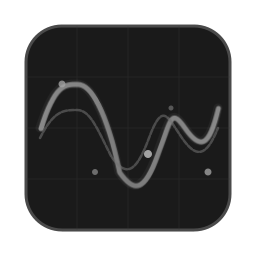
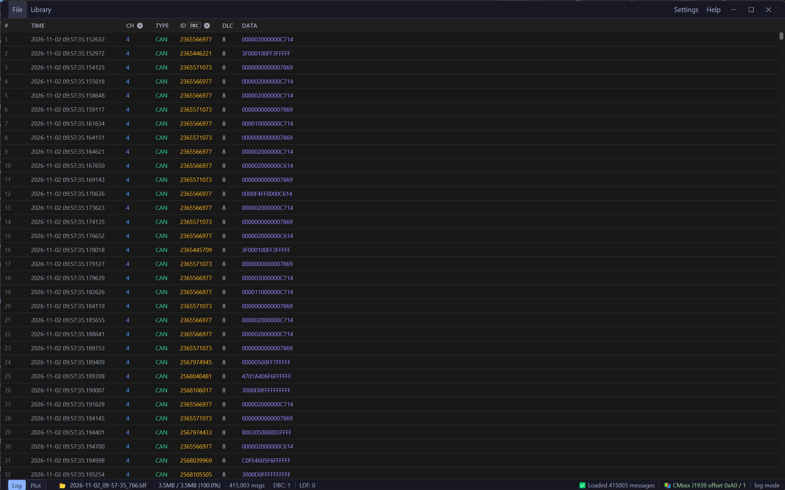
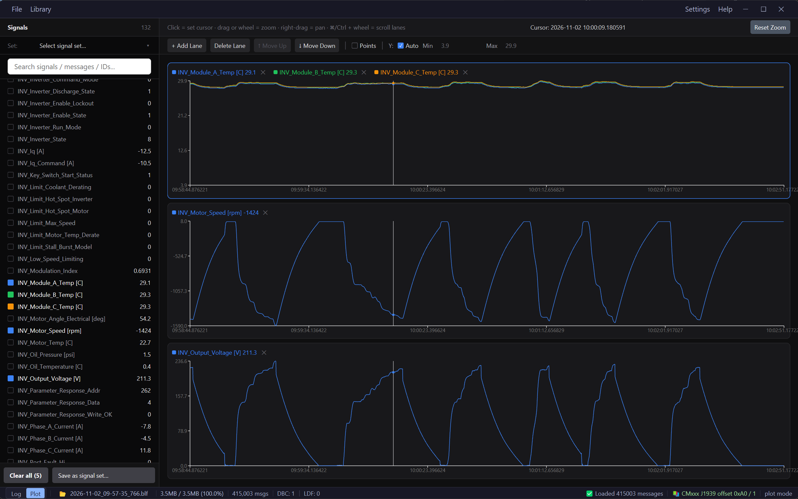
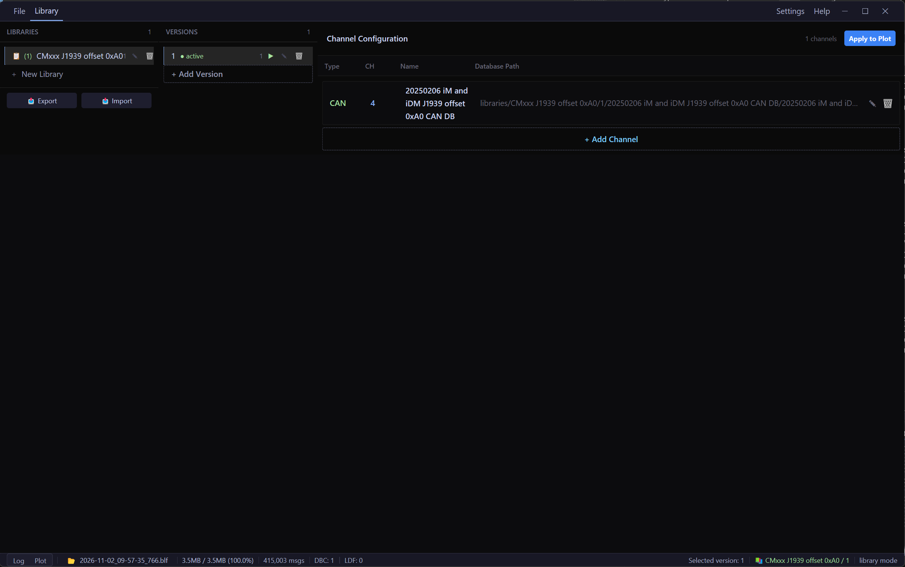

<div align="center">

# CANdata



**Open-source CAN/LIN bus data analysis tool for Windows**

[](https://github.com/ChrisBruneEngr/CANdata/actions)
[](LICENSE.txt)
[](https://github.com/ChrisBruneEngr/CANdata/releases)

</div>

---

## Overview

CANdata is a desktop tool for inspecting CAN bus recordings. It reads Vector BLF log files, decodes signals with DBC and LDF databases, and plots them in a GPU-accelerated interface built with Rust and [GPUI](https://gpui.rs/).

A typical session: drop one or more `.blf` recordings onto the window, activate the DBC for each channel, browse the decoded log, then plot the signals you care about and zoom in on the interesting parts.

CANdata runs on Windows 10 and 11 (x64). It is portable and makes no network connections.

---

## Features

**Logs and databases**
- Reads BLF recordings with CAN, CAN FD, LIN, FlexRay and Ethernet frames
- Decodes signals with DBC (CAN) and LDF (LIN) databases
- Fast loading: decompression runs in parallel across CPU cores
- Filters the log by message ID and channel

**Signal libraries**
- Keeps several versions of each DBC/LDF database per channel, with one-click activation and auto-load on startup
- Signal sets: save a named set of channel/message/signal selections and re-apply it to any recording
- Export a library, with its database files, to a single `.cvlib` file and import it on another machine

**Plotting**
- Interactive plot with lanes, zoom, pan, cursor readout and auto or fixed Y ranges
- Signals with no data in the recording are marked in the plot

**Multiple recordings**
- Load several BLF files onto one timeline, aligned by their absolute timestamps
- Drag and drop `.blf` files or a folder; a confirmation appears before loading more than 1 GB
- Parse errors are flagged in the status bar, with details per file

---

## Screenshots

| Log view | Plot view |
|:---:|:---:|
|  |  |

| Library view |
|:---:|
|  |

---

## Install

Download the latest release from the [Releases page](https://github.com/ChrisBruneEngr/CANdata/releases):

- **Installer** (`candata-Setup-vX.Y.Z.exe`): installs for the current user under `%LOCALAPPDATA%\Programs\CANdata` and adds a Start menu shortcut. No administrator rights needed.
- **Portable ZIP** (`candata-vX.Y.Z.zip`): unzip anywhere you can write to and run `candata.exe`.

Both include the user guide and a demo database with a matching recording in `samples\`.

CANdata saves its settings (`multi_channel_config.json`), signal sets (`signal_sets.json`) and library files (`libraries\`) next to `candata.exe`. Copy the folder to move your whole setup. Keep it out of `C:\Program Files`, which is read-only for normal users.

---

## Quick start

1. Start CANdata and drag a `.blf` file onto the window, or use **File → Open BLF...** (replaces what's loaded) or **File → Open Multiple BLF...** (adds to it).
2. Click **Library**, create a library and a version, and add a channel that points to your DBC or LDF file. Activate the version.
3. Browse the decoded frames in the **Log** view, or switch to **Plot** (bottom-left of the status bar) and select signals from the sidebar.

To try it with demo data, use `samples\demo.blf` and `samples\demo.dbc` (channel 1) from the installed or unzipped folder.

The [user guide](docs/USAGE.md) covers every view, library management, signal sets, export/import and troubleshooting.

---

## Build from source

**Requirements:** Windows 10 or 11 (x64), [Rust](https://www.rust-lang.org/tools/install) stable (1.85 or later) with the MSVC toolchain, and Git.

```bash
git clone https://github.com/ChrisBruneEngr/CANdata.git
cd CANdata
cargo run --release --bin candata
```

The demo recording isn't stored in the repository. Generate it next to `demo.dbc` with:

```bash
cargo run --release -p blf --bin gen_demo_blf
```

### Development

```bash
cargo test --workspace     # run the tests
cargo clippy --workspace   # lint
cargo fmt --all            # format
```

### Packaging

```powershell
.\scripts\package.ps1 -Version 1.0.0          # portable ZIP in release-package\
.\scripts\build-installer.ps1 -Version 1.0.0  # installer in installer-output\ (needs Inno Setup 6)
```

Pushing a tag such as `v1.0.0` runs the [release workflow](.github/workflows/release.yml), which builds both and publishes a GitHub release.

---

## Feedback

Bug reports and suggestions are welcome on [GitHub Issues](https://github.com/ChrisBruneEngr/CANdata/issues).

---

## Acknowledgements

CANdata began as a fork of [can-viewer](https://github.com/cantool/can-viewer) by cantool, released under the MIT License. The BLF parser, DBC/LDF parsers and the original GPUI interface come from that project; CANdata has since been substantially reworked. Many thanks to the can-viewer authors for making their work open source.

---

## License

[MIT License](LICENSE.txt). Copyright © 2026 can-viewer (original work) and © 2026 Chris Brune (CANdata modifications). The original can-viewer copyright and permission notice is kept in [LICENSE.txt](LICENSE.txt), as the MIT License requires.
